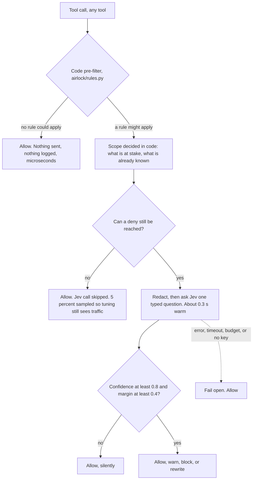
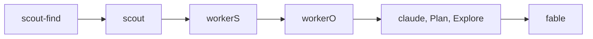

<div align="center">

<h1>jev-kit</h1>

<p>
  <strong>Everything you need to run TypeSafe's Jev with Claude Code:</strong><br/>
  guard your agent's tool calls, right-size its sub-agents, and wire Jev into
  search, browsing, review and more.
</p>

<p>
  <a href="LICENSE"></a>
  
  
  
  
  
</p>

<p>
  <a href="#quickstart">Quickstart</a> &middot;
  <a href="#what-is-in-the-kit">What is in the kit</a> &middot;
  <a href="#jev-as-the-decision-maker-the-browser-agent">Browser result</a> &middot;
  <a href="#how-it-works">How it works</a> &middot;
  <a href="#measured-results">Measured results</a> &middot;
  <a href="#safety-model">Safety</a> &middot;
  <a href="#faq">FAQ</a>
</p>


</div>

> **Jev decides, Claude writes.** With Jev choosing each click, the browser
> agent's Claude bill was **0.0008 USD** a run against **0.1868 USD** with
> Sonnet choosing, at the same 9/9 success. [The numbers, and how they were
> taken.](#jev-as-the-decision-maker-the-browser-agent)

## What is Jev, and why a kit

Jev is a TypeSafe System One model. It does not return text. It returns a typed
decision with a probability attached: yes or no, a choice, a score. That takes
roughly 0.3 s and costs a fraction of a cent, so it fits inside an agent's loop
as a judge rather than beside it as another chat.

A kit, because the judge is the easy part. The work is the places it pays off:
which tool call to question, which sub-agent rung a task needs, what to redact
before sending, and how to fail open when no answer arrives. This repository is
that wiring, built and measured.

## Quickstart

```bash
git clone https://github.com/jonathanavis96/jev-kit.git ~/code/jev-kit
cd ~/code/jev-kit
install/install.sh          # guard + session check + daemon + monitoring
                            # + filesearch + claude-update + belay,
                            # all under $HOME
```

**On native Windows without WSL**, that is not the install: the installer is
Python, not bash. Follow
**[docs/INSTALL-WINDOWS.md](docs/INSTALL-WINDOWS.md)** instead.

`install.sh` never runs `sudo`, never writes outside `$HOME`, and never edits a
`settings.json` unless you pass `--wire`. Without `--wire` it prints the exact
JSON to add and stops. `--check-only` prints the plan and installs nothing.

**The one thing a human supplies** is a `TYPESAFE_API_KEY`. Every component in
the kit reads the same one, so it lives at a kit-level path:

```bash
mkdir -p ~/.config/jev-kit && chmod 700 ~/.config/jev-kit
touch ~/.config/jev-kit/env && chmod 600 ~/.config/jev-kit/env
$EDITOR ~/.config/jev-kit/env        # one line: TYPESAFE_API_KEY=...
```

Type it into the file with an editor. **Never print it**, never paste it into a
session, never echo it back to confirm it. Without a key everything still
installs and still fails open; only the code-only rules fire.

### Prove it works

`install/doctor.sh` runs a real deny and a real allow through the actual hook
process against a throwaway `HOME`. To see it with your own hands, pipe a fake
`PreToolUse` event at the hook:

```bash
printf '%s' '{"session_id":"t","cwd":"/tmp","tool_name":"Bash","tool_input":{"command":"xdg-open https://example.com"}}' \
  | AIRLOCK_MODE=enforce python3 ~/.local/share/airlock/current/hooks/airlock.py
```

That prints JSON containing `"permissionDecision": "deny"`. An ordinary command
prints **nothing at all**:

```bash
printf '%s' '{"session_id":"t","cwd":"/tmp","tool_name":"Bash","tool_input":{"command":"echo hello"}}' \
  | AIRLOCK_MODE=enforce python3 ~/.local/share/airlock/current/hooks/airlock.py
```

### Shadow first, then enforce

The default is **shadow**: the real rules table runs, the log records what
enforce would have done, and nothing is blocked. Read the log for a while, then
arm it.

```bash
python3 -m airlock.report                 # what shadow mode would have done
echo enforce > ~/.config/airlock/mode     # a deny now blocks
echo shadow  > ~/.config/airlock/mode     # back to log-only
```

Kill switch, which beats the mode entirely: `export AIRLOCK_DISABLE=1` for this
shell, or `touch ~/.config/airlock/disabled` for the machine.

> ### Or tell your agent
>
> Paste this into Claude Code:
>
> *"Install jev-kit from https://github.com/jonathanavis96/jev-kit. Follow
> docs/install.md, run `install/install.sh --check-only` first and show me the
> plan, ask me for the TYPESAFE_API_KEY rather than printing one, leave it in
> shadow mode, and prove a deny works before telling me it is done."*

Full detail, flags, config file, WSL, rollback and the agent checklist:
**[docs/install.md](docs/install.md)**.

## What is in the kit

Airlock is the tool-call guard. It is one component of the kit, not the kit.

`Exercised` means unit tests, a labelled eval, a measured bench and real daily
use on at least one machine. `Experimental` means unit tests and hand-runs
only: no labelled corpus, no measured numbers, no sustained use.

| Component | What it does | Default | What leaves the machine | Exercised |
|---|---|---|---|---|
| **Guards** | | | | |
| Airlock, the tool-call guard | Judges each `PreToolUse` call: rules table first, one typed Jev question for the ambiguous half | **yes** | Redacted call summaries | exercised |
| Tier guard | Checks the sub-agent rung a dispatch chose against the task | **yes**, part of the guard | Dispatch description and prompt, redacted | exercised |
| Belay | Sends a finished-but-unverified agent back to check its work | **yes** | Task text and check commands, redacted | exercised |
| Session check | Says at session start when the guard has stopped judging | **yes** | Nothing. Local state only | exercised |
| **Speed and cost** | | | | |
| Warm daemon | Holds a warm connection: 0.3 s a judgement, not 0.9 s | **yes** | Nothing of its own | exercised |
| Compaction | Installs the community `fast-jev-compaction` plugin | no, opt-in | **Up to 25,000 tokens of raw tool inputs and results per request** | never enabled here |
| File search | Per-user `plocate` index of `$HOME`, refreshed hourly | **yes** | Nothing. Local | exercised |
| File search (Windows) | Detects [Everything](https://www.voidtools.com/) (`es.exe`) and steers searches at it. Never installs it | **yes** on Windows | Nothing. Local | one Windows 11 machine |
| **Uses** | | | | |
| Browser agent | Jev decides each click, or a warm planner does with `plan: true`. Vendored at a pin | no, opt-in | Page state and goals, to the decider you configure | own numbers |
| Review | A Jev code reviewer at a pin, with a fail-open wrapper | no, opt-in | Diffs, to the gate you configure | no numbers here |
| Document classifier | Two-stage classifier with an escape hatch and a confidence gate | no | Page text, when you call it | **experimental** |
| Log triage | Redact-first, local-rules-first triage on stdin | no | Redacted lines, once local rules run out | **experimental** |
| Shim | An OpenAI-shaped HTTP shim over the `claude` CLI | no, opt-in | Whatever you send through it | **experimental** |
| **Operations** | | | | |
| Installer and doctor | Install, doctor with real calls, deploy, rollback, wire | n/a | Nothing | exercised |
| Monitoring | Five-minute health check and its timer | **yes** | Nothing | exercised |
| Push monitor | Pushes status to a monitor you host, in one of two modes | no, opt-in | A status word, plus which check failed, redacted and capped | exercised |
| Tuning loop | Scores shadow-log verdicts, commits to its own branch | no, opt-in | Claude sessions on the account you nominate | exercised |
| Auto-updater | Updates Claude Code, and only while no run is alive | **yes** | Nothing | exercised |

Per-component detail, exposure and install flags:
**[docs/components.md](docs/components.md)**. The rules themselves:
**[docs/rules.md](docs/rules.md)**.

The guard's steer toward `graphify query` instead of a raw recursive grep only
exists where the search root carries a graph (`graphify-out/graph.json`). With
no graph the branch is inert, which covers most users.

## Jev as the decision-maker: the browser agent

A browser agent is where swapping the decision-maker shows up plainest. Same
goals, same browser, same code. Only the model choosing each click changes.

| Decider | Goals reached | Median decision | Claude spend per run |
|---|---|---|---|
| **Jev** | **9/9** | **314-486 ms** | **0.0008 USD** |
| Claude Sonnet | 9/9 | 1.1-1.5 s | 0.1868 USD |
| Claude Haiku | 4/9 | 0.76-2.8 s | 0.0344 USD |

Jev reached every goal Sonnet reached, two to four times faster per decision,
for 233 times less Claude spend per run. The bill collapses because the
language model is no longer asked to decide each click, only to write text into
a field.

Method: 3 goals, 3 arms, 3 repetitions each (27 runs), one machine, one shared
headless Chromium, 2026-09-19. Spend is goal 1, read from the CLI's own
`total_cost_usd`. At n=3 a cell is directional, not significant. Full tables:
**[docs/measurements.md](docs/measurements.md#the-browser-component)**.

A session reaches it through one MCP tool, `browse`, which
[browse/](browse/README.md) serves over stdio. Give it a goal and it returns
the final URL, the page text and whatever a CSS selector picked out.

The guard points at that tool. `R11-browse-via-jev` matches a Playwright MCP
plain read/navigate/click call by its tool name. As a session's first browser
call, it is denied with the one-line usage of `browse`.

Playwright tools `browse` cannot express (file uploads, scripted code,
dialogs, drag and drop) are always allowed. The first one opens Playwright for
the rest of the session. Housekeeping calls such as tabs, screenshots and
network inspection are allowed too, but open nothing.

The match is code only: Jev is never asked and nothing is scored. Shell
commands and Playwright scripts are never looked at, and the Playwright
servers stay registered. See
[docs/rules.md](docs/rules.md#r11-browse-via-jev-a-playwright-mcp-call-is-pointed-at-browse).

`browse` cannot do everything, so the rule gives way when it fails. Jev chooses
one step at a time out of what it can see, which puts a multi-hop task out of
reach. When a `browse` call comes back `blocked`, or errors, a PostToolUse (or
PostToolUseFailure) hook records it and R11 warns instead of blocking for the
rest of that session. Nothing else opens it except an always-allowed
Playwright call (above): a stamp and a repeat still do nothing.

## jev-ultrafast, the vendored agent

The agent behind `browse` is
[browser-use/jev-ultrafast](https://github.com/browser-use/jev-ultrafast), MIT
licensed and written by **Browser Use**. It is vendored at
[`vendor/jev-ultrafast`](vendor/jev-ultrafast) with `git subtree`, pinned at
upstream commit **`1231850`**. Its licence travels with it, and
[`NOTICE`](NOTICE) records the copy and our changes. Thanks to Browser Use for
the original.

Our changes on top of the pin, all in this repository's history:

- Headless CDP attach, so the agent drives a Chromium somebody else started.
- A warm Claude Haiku child writes field text, with thinking off.
- Off-screen links are offered and scrolled into view, and the first scroll
  after a navigation is no longer dropped.
- Requests follow TypeSafe's own documentation: options named by meaning, short
  page text, extra judgments in the same request, DONE gated on confidence. See
  [docs/jev-reference/USING-JEV.md](docs/jev-reference/USING-JEV.md).
- `plan: true` puts a warm Sonnet planner, effort low, in front of Jev for
  tasks whose steps are not spelled out.

On a Wikipedia suite of eight tasks, three runs each, on 23 September 2026:

| Arm | Hops named | No hops named | Median cost, named / not |
|---|---|---|---|
| Jev alone | 15/18, 7.1 s | 0/6 | not reported by `browse` (Haiku writes field text) |
| `plan: true`, Sonnet low | 16/18, 16.4 s | 6/6, 33.5 s | $0.048 / $0.113 |
| Sonnet on Playwright MCP | 17/18, 26.0 s | 6/6, 47.1 s | $0.099 / $0.182 |

Haiku as the planner, the per-task results and the method are in
[docs/measurements.md](docs/measurements.md#the-wikipedia-suite).

To move to a newer upstream:

```bash
git subtree pull --prefix vendor/jev-ultrafast \
  https://github.com/browser-use/jev-ultrafast <commit> --squash
```

[browser/README.md](browser/README.md) says what to re-run afterwards.

## How it works

The hook is registered for **every** tool. What filters a call is not the
matcher but the rules table, and the cheap paths come first: most calls never
reach the network, and a call no rule covers costs nothing and logs nothing.



The tier guard runs the same way on an `Agent` dispatch. It asks Jev what kind
of task this really is, maps that to a rung on your ladder, and acts on the
gap:



| gap between chosen rung and needed rung | what happens |
|---|---|
| cheaper than the task needs | logged as under-tiered. Never blocked, never corrected upward |
| the right rung | nothing at all |
| one rung too expensive | allowed, with a two-line note naming the cheaper `subagent_type` |
| two or more rungs too expensive | blocked, with the cheaper type named in the reason |
| `fable` with no prior failed attempt stated | blocked |

The ladder is yours: `~/.config/airlock/tiers.json` overrides the built-in one,
because agent type names differ per machine. Rewrite mode, which edits the
dispatch instead of advising, exists and is off by default for a reason set out
in [docs/rules.md](docs/rules.md#rewrite-mode-off-by-default-and-here-is-the-catch).

## Measured results

Every number below was measured in this repository, on a stated date, by a
stated command, on a 4 vCPU cloud VM in Europe (Ubuntu, 8 GB RAM, Python 3.14).
Nothing is extrapolated.

| What | Number | How it was measured |
|---|---|---|
| Hook latency, no rule matches | **33.2 ms** median, 42.4 ms p95 (Bash); 26.9 ms median (Write) | `python3 tests/latency_hook.py 200`, 2026-09-19. Real hook processes, temp `HOME`, no key, nothing reached the network. Bare `python3 -c pass` is about 23 ms here |
| Hook latency, code-only decision | **37.7 ms** median (deny); 36.5 ms (warn) | same run |
| Judgement latency | about **0.3 s** warm daemon, about 0.9 s cold HTTPS | round figures for a single call on an idle daemon |
| Judgement throughput | **572 ms** mean per judgement | 58 real Jev calls at four-way concurrency, `python3 -m airlock.eval`, 2026-09-19. Throughput under load, not single-call latency |
| Deny-capable rule accuracy | **100%**, zero false denies | `python3 -m airlock.eval`, 2026-09-19, on labelled cases per rule (R1 16, R2 8, R3 10, R4 11, R5 9, R6 9, R7 10, R9 9) |
| `R10-general-risk` accuracy | **95.2%** (20/21), zero false denies | same run, 21 labelled cases. Was 88.9% before the quieting pass. It can only warn, so a false deny is structurally impossible |
| `R10` pre-filter skip rate | fired on **2 of 284** Bash calls (0.7%); consulted on 0 | the existing shadow log. Every row there is a call a specific rule had already claimed |
| Tier-guard accuracy | **98.2%** (56 of 57 scored), zero false denies, zero missed denies | `python3 -m airlock.eval`, 2026-09-19, 58 labelled Agent dispatches. Block 18/18, silent 29/29, warn 9/10 |
| `task_kind` calibration | **98.0%** accuracy, ECE 1.9%, over 50 labelled rows | `tuning/calibrate.sh`, 2026-09-19 |
| `search_intent` calibration | **84.4%** accuracy, ECE 12.6%, over 32 labelled rows | same run. The weaker of the two guards |
| `subagent_type` ablation | `task_kind` **did not move**, 30/30 across five rungs | `python3 eval/ablation.py`, 2026-09-19. Thirty cases on five prompts is not a general result |
| Browser agent, Jev as decider | **9/9** success, **314-486 ms** median decision | `browser/README.md`, 2026-09-19. Sonnet 9/9 at 1.1-1.5 s; Haiku 4/9 at 0.76-2.8 s. n=3 per cell, directional only |
| Browser agent, Claude cost per run | **0.0008 USD** with Jev against **0.1868 USD** with Sonnet deciding (goal 1) | same sweep. Cost is the CLI's own `total_cost_usd`, never tokens multiplied by a price |
| A/B bench, guard against no guard | **zero denies** over 30 sessions | `bench/results/20260919-120344.md`, 2026-09-19, enforce mode, five tasks |

**Read that last row as a backstop, not a tax.** Thirty sessions of ordinary
agent work produced nothing worth blocking, because agents already pick the
right tool almost every time. The bench shows the guard is cheap and stays out
of the way. It does not show that the guard has saved anything yet, and that is
why the guard now skips the Jev call when the code-computed facts make a deny
unreachable.

Full tables, methods and the known limits: **[docs/measurements.md](docs/measurements.md)**.

## Safety model

- **Fail open, everywhere.** Any error, timeout, missing key or unreachable
  daemon means the tool call is allowed. A broken guard can never block or slow
  a tool call.
- **A time budget.** Enforce mode gives a judgement a hard budget; past it, the
  call runs.
- **An override stamp.** `[airlock-ok: <reason>]` in a call's description gets
  past any deny, with the reason recorded.
- **Loop protection.** The same call is never denied twice in ten minutes.
- **One rule ignores those two.** `R11-browse-via-jev` is a cost steer with an
  equally good tool sitting in the same session, so a stamp on it is logged and
  refused and a repeat is denied again. The other nets still cover it, and only
  the user turns it off. Its one door is the `browse` tool failing: a `blocked`
  or errored `browse` call turns the rule into a warn for thirty minutes.
- **A kill switch that beats the mode.** `AIRLOCK_DISABLE=1`, or
  `~/.config/airlock/disabled`, or `echo off > ~/.config/airlock/mode`.
- **Confidence bars.** Where Jev decides, a deny needs confidence of at least
  0.8 and a margin of at least 0.4 over the runner-up. Rewrite mode needs 0.9
  and 0.5.
- **What leaves the machine.** Redacted summaries of the ambiguous fraction of
  tool calls, and nothing else, unless you opt into a component whose row above
  says otherwise. Never a raw tool result: every string passes through
  `airlock/redact.py` first, and truncation happens after redaction so a secret
  straddling the boundary is not half-leaked. Compaction is the one large
  exposure, which is why it is never installed for you.
- **This is not a security control.** It is a cost and hygiene guard that fails
  open by design. A control that depends on an agent choosing to obey it is not
  a control. If something must not happen, restrict it at the platform.

<!-- BEGIN PLATFORM TABLE -- keep this section self-contained; the native-Windows work edits it -->
## Platforms

| Platform | State today |
|---|---|
| **Linux** (systemd user session) | Fully supported, and what every measured number here came from. Guard, warm daemon, all timers, `plocate` file search. |
| **WSL2** (Ubuntu, systemd on) | Supported. Identical to Linux once `systemd=true` is in `/etc/wsl.conf` and the distribution has been restarted. See [INSTALL-WSL.md](docs/INSTALL-WSL.md). |
| **WSL2** (systemd off) | Works, degraded, and the installer detects it. No daemon (a direct HTTPS call per judgement, roughly 0.9 s instead of 0.3 s), no timers, no hourly index refresh. The guard itself is unaffected. |
| **macOS** | Plausible but **untested**. The guard is stdlib Python and should run. There is no systemd, so `--no-systemd` is required, and the daemon, all timers and `plocate` are out. `launchd` equivalents are not written. Nobody has run it. |
| **Native Windows** (no WSL) | **The core is supported**, and was run on a real Windows 11 machine, including the Jev-judged path with a real key (2026-09-19). Guard in shadow and enforce, the whole rules table, the key file, file search steered at [Everything](https://www.voidtools.com/) (`es.exe`) instead of `plocate`, health check, installer, doctor, uninstaller. **No warm daemon**, and belay, compaction, browser, review and tuning are **not ported**. See [INSTALL-WINDOWS.md](docs/INSTALL-WINDOWS.md), and [native-windows.md](docs/native-windows.md) for what is done and what remains. |

### What "supported" means on native Windows

| | |
|---|---|
| **Works** | The `PreToolUse` guard in shadow and enforce mode, through the Bash tool and the PowerShell tool alike. The whole rules table, with no per-platform exceptions: R6 (GUI/browser) is `off` by default on every platform, Windows included, and `rules.json` turns it on where the machine really is headless. The key file at `%APPDATA%\jev-kit\env`, with `%APPDATA%\airlock\env` still honoured. The file-search rule, steering at `es.exe` with path-scoped, regex and case flags. The health check. `install/windows_install.py`, `windows_doctor.py`, `windows_uninstall.py` and their `.cmd`/`.ps1` launchers. |
| **Out of scope, by design** | **The warm daemon.** It listens on a Unix domain socket, which Windows does not have; the client falls back cleanly to a direct HTTPS call per judgement, about **0.9 s** cold against about **0.3 s** warm on Linux. A named pipe is the right analogue but needs a non-stdlib dependency, and a localhost TCP listener is precisely the design this project refuses. |
| **Out of scope, not ported** | `belay`, `compaction`, `browser`, `review`, `tuning`. Also `filesearch/`: on Linux airlock *builds* the index, and on Windows it does not. Everything is third-party software with its own installer and service, so airlock only *detects* it and steers at it, and never installs it. |
| **Tested how** | The unit suite on **Windows Python 3.11.9, Windows 11**. Real `PreToolUse` events piped at the installed hook: a deny through the Bash tool and the same deny through the PowerShell tool (R1, an attempt to print the key file), an allow, the Everything steer classified, a malformed payload and the kill switch. The installer, doctor and uninstaller run for real into a scratch directory. `es.exe` 1.1.0.38 detected and queried. Exact commands and output: [docs/native-windows.md](docs/native-windows.md). |
| **Verified on Windows** | **The Jev-judged path, 2026-09-19**, Windows Python **3.11.9** on Windows 11, with a real key in a throwaway profile that was destroyed afterwards: judged search denies through the Bash tool and the PowerShell tool, a judged allow, the tier guard blocking two rungs over and warning one rung over, the tier rewrite, the doctor and the health check's direct HTTPS probe. Measured judged latency over 32 calls: median **1030 ms**, max **1359 ms** (no warm daemon there). |
| **The enforce budget on Windows** | **2000 ms, decided and applied** (POSIX, WSL and macOS stay at 1500 ms). One of those 32 calls died on a TLS handshake timeout and fail-opened (3.1%) against the then-1500 ms budget; Windows has no warm daemon, so every judgement is a fresh HTTPS connection. 2000 ms clears the measured 1359 ms max with room to spare. Details: [native-windows.md](docs/native-windows.md). |
<!-- END PLATFORM TABLE -->

## FAQ

<details>
<summary><b>What does it cost?</b></summary>

A Jev judgement costs a fraction of a cent, and most tool calls never make one.
The browser agent's decision loop came to 0.0008 USD of Claude spend a run,
against 0.1868 USD with Sonnet deciding. Your own bill follows your traffic,
which is why the tuning loop reads your shadow log instead of quoting a figure.

</details>

<details>
<summary><b>Does it slow my agent down?</b></summary>

A call no rule covers adds 33.2 ms, and about 23 ms of that is interpreter
start-up you would pay for any hook at all. A call that does reach Jev adds
about 0.3 s through the warm daemon. Enforce mode caps that with a hard budget,
past which the call runs anyway. Every figure:
[docs/measurements.md](docs/measurements.md#hook-latency).

</details>

<details>
<summary><b>Can it block something wrongly, and how do I get past it?</b></summary>

Yes it can, and there are four ways out, in rising order of permanence:

- `[airlock-ok: <reason>]` in the call's description, with the reason logged.
- Downgrade or disable that one rule in `~/.config/airlock/rules.json`.
- `export AIRLOCK_DISABLE=1` for the shell.
- `echo shadow > ~/.config/airlock/mode` to stop blocking anything.

Loop protection also means the same call is never denied twice in ten minutes,
so a retry gets through on its own.

`R11-browse-via-jev` is the exception to the first and the last of those. A
stamp on it is logged and refused, and a repeat is denied again.

Use `browse` for reading, navigating and simple click-through. Uploads,
scripted code, dialogs and signed-in multi-step work go straight to
Playwright: those calls are never blocked, and the first one opens Playwright
for the rest of the session. A `browse` call that comes back `blocked` or errors does the
same, with no stamp needed. Past that, ask the person to switch the rule off.

</details>

<details>
<summary><b>Is my code sent anywhere?</b></summary>

No. TypeSafe gets a redacted summary of the ambiguous fraction of tool calls:
the command line, or the dispatch description. Never a tool result, never file
contents, never a diff. Every string passes through `airlock/redact.py` first.
The two exceptions are opt-in and named in the table above: compaction sends
raw tool inputs and results, and review sends diffs.

</details>

<details>
<summary><b>What if TypeSafe is down?</b></summary>

Everything fails open. No judgement means the tool call is allowed. The
code-only rules keep working with no network at all: R5 sudo, R6 GUI, R9 commit
secret, and the code halves of R1, R3, R4 and R7.

</details>

<details>
<summary><b>Does it work on Windows?</b></summary>

Yes, on native Windows without WSL, and the core was run on a real Windows 11
machine on 2026-09-19. The installer is Python rather than bash, there is no
warm daemon, and file search steers at `es.exe` rather than `plocate`. Belay,
compaction, browser, review and tuning are not ported.

Start at **[docs/INSTALL-WINDOWS.md](docs/INSTALL-WINDOWS.md)**; what is done
and what remains is in [docs/native-windows.md](docs/native-windows.md).

</details>

<details>
<summary><b>I run this on a headless server.</b></summary>

Turn on **R6** (`R6-gui-or-browser`), which blocks `xdg-open`, `wslview`,
`explorer.exe` and the browser binaries, and which `install/install.sh` sets for
you when it detects a headless machine.

```
(cd ~/.local/share/airlock/current && python3 -m airlock.headless merge ~/.config/airlock/rules.json)
```

Why R6 ships off, what counts as headless, and the `--headless` and
`--no-headless` flags: **[docs/install.md](docs/install.md#headless-machines-and-rule-r6)**.

</details>

<details>
<summary><b>How do I know the guard is still working?</b></summary>

It tells you. The **session check** is a `SessionStart` hook, installed by
default. It reads local state and says one short thing when the guard is not
judging: the mode is off, no key resolves, the last health row is bad or stale,
or tuning could not run. It prints nothing at all when everything is fine, and
it never calls the network.

On a server, use the five-minute health timer and a push monitor that alerts
when the pushes stop. On a workstation, silence means the machine is off, so set
`AIRLOCK_KUMA_PUSH_MODE=explicit` instead. See
[monitoring/README.md](monitoring/README.md), or run `install/doctor.sh` to see
the whole picture at once.

</details>

<details>
<summary><b>Why is the guard called "Airlock", and is it a sandbox?</b></summary>

It is not a sandbox. Other projects of that name isolate agents or untrusted
code in a VM or a container. This is a policy hook inside your own session that
judges individual tool calls and at most returns a deny to Claude Code. The
name covers the guard component alone, and the kit around it is jev-kit.

It was `jev-guard`, then `plumbline`, and both older names still work. The
forced rename and the cutover:
[docs/components.md](docs/components.md#why-the-guard-is-called-airlock) and
[docs/MIGRATING-TO-AIRLOCK.md](docs/MIGRATING-TO-AIRLOCK.md).

</details>

<details>
<summary><b>Does it work without systemd?</b></summary>

Yes, degraded, and the installer detects it and says so. You lose the warm
daemon (0.9 s a judgement rather than 0.3 s), the health-check and tuning
timers, and the hourly index refresh. The guard is one Python process per tool
call and needs nothing scheduled.

</details>

<details>
<summary><b>Can I use just one piece of it?</b></summary>

Yes. Every component except the guard is optional and separately installable by
flag. Browser, review, shim, docclass and logtriage do not need the guard at
all.

</details>

## Roadmap

What is known to be missing or unfinished, with nothing promised to a date:
**[ROADMAP.md](ROADMAP.md)**.

## Credits

The ported patterns, the community projects they came from and the published
work cited along the way: **[docs/CREDITS.md](docs/CREDITS.md)**.

## Contributing

Issues and pull requests are welcome.

- `python3 -m unittest discover -s tests` must pass. It is fully mocked, so it
  needs no key and makes no network calls.
- `python3 tools/check_docs.py` must pass: it resolves every relative link in
  the README and `docs/`, and checks every Mermaid block.
- `python3 tools/check_prose.py README.md` must pass. It flags machine-writing
  phrases, em dashes, long sentences, flat rhythm and walls of text; add
  `--fix-hints` for a plainer form where a mechanical one exists.
- A rule change needs labelled cases in `eval/`. **No real data in an eval
  case**: no real paths, hostnames, usernames, tokens or customer names. Write
  the shape, not the incident.
- A rule with any false deny on its eval cases ships as `warn`, not `deny`.
- Everything fails open. A change that can raise in the hot path is a bug, even
  if it is correct.
- Measured claims carry their method and their date, or they do not go in.

## Licence

MIT. See [LICENSE](LICENSE), and [NOTICE](NOTICE) for the third-party
components this kit clones or patches.
